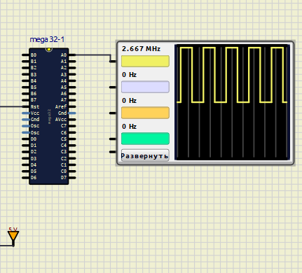

# 01. Генератор прямоугольных импульсов (Меандр)

Программа генерирует стабильный прямоугольный сигнал на портах ввода-вывода микроконтроллера ATmega32. 

## ⚙️ Описание работы
За счет использования двух инструкций `nop` один полный цикл переключения занимает ровно 6 тактов процессора. При частоте микроконтроллера 16 МГц виртуальные приборы в симуляторе фиксируют частоту сигнала **2.667 MHz**.

* **Исходный код:** `main.asm`
* **Файл прошивки:** `AssemblerApplication3.hex`
* **Схема для симуляции:** `circuit.simu.sim1` (открывать в SimulIDE)

## 📈 Результат симуляции

